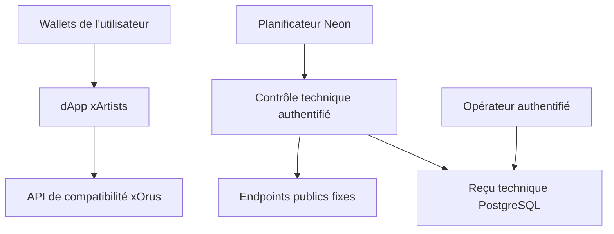

# xOrus — organisation commune et passerelle de plateformes

Ce service rattache les ressources à une seule organisation **logique** `xartists`. Il ne fusionne pas les comptes fournisseurs, ne déplace pas les fonds et ne multiplie pas les quotas gratuits. Les identifiants des cinq organisations évoquées par le propriétaire ne sont pas encore tous identifiés.

Le service comprend une API de compatibilité et deux agents déterministes d'observation des réseaux **MultiversX mainnet** et **Solana mainnet**, avec une cadence cible de quinze minutes. Les décisions restent `ABSTAIN`, avec zéro signal de marché indépendamment vérifié. Aucun modèle IA, signer, ordre ou wallet lié n'est configuré dans ce service. Un manifeste public décrit les capacités ; seul un reçu persisté démontre une exécution effective.

## Composants et limites de confiance



| Composant | Livré | Limite |
| --- | --- | --- |
| Registre commun | `/v1/xorus/platforms`, une organisation logique | Aucun transfert de compte fournisseur |
| Routage wallet | EVM, Solana, Bitcoin, MultiversX selon plateforme | Compatibilité déclarative ; aucun wallet lié |
| Contrôles réseau | Bitcoin, Solana, Polymarket, Kraken | Disponibilité technique ; aucune observation de prix |
| Agents réseau | `/v1/xorus/agents` (manifeste), `/v1/xorus/agents/reports` (opérateur) | Observations déterministes, aucune inférence IA ni décision d'investissement |
| Planificateur | Trigger Neon existant renommé `xorus-hub-cycle`, `*/15 * * * *` UTC | Vérifier l'état fournisseur et un reçu persisté après chaque déploiement |
| Stockage | Une ligne `xorus_platform_hub_state`, lease partagée entre isolates | Cible sandbox nominative exclusivement |
| Lectures opérateur | Bearer serveur distinct, jamais livré au navigateur | Ne remplace pas une session utilisateur ou une preuve wallet |
| Exécution / IA | Non implémentées | Refus HTTP 503 ; aucun flag ne les active |

Les réponses externes sont des données non fiables : URLs fixes, redirections refusées, timeout 5 secondes pour les sondes et budget total de 10 secondes par agent, réponses limitées à 8 KiB. Aucun contenu externe n'est interprété comme une instruction. Un agent défaillant n'empêche pas l'autre de terminer ; ses anciennes observations ne sont jamais réutilisées.

### Observations et fraîcheur

- MultiversX : deux GET séquentiels `network/config` et `network/status/4294967295`, identité `chain_id=1`, nonce/finalité/époque **de la metachain seulement**, durée de round fournie par la configuration, horodatage réel du bloc. Une différence de nonces n'est jamais convertie en secondes.
- Solana : `getGenesisHash` vérifie le cluster mainnet ; `getEpochInfo` utilise `finalized` ; `getBlockTime` donne l'heure du slot finalisé ; `getRecentPerformanceSamples(1)` donne un échantillon de débit. Le débit hors votes reste `null` si absent. L'écart échantillon/slot finalisé est limité à 600 slots ; ce n'est pas une source de prix ou un débit garanti.
- Les blocs de plus de 120 secondes sont `stale`. Une heure future de plus de cinq secondes, une identité erronée, un compteur incohérent, un RPC en erreur ou une réponse manquante donnent `unavailable`. `checked_at` ne rafraîchit jamais `source_data_at`.
- Les rapports authentifiés exigent un reçu âgé de 30 minutes au plus. Ils donnent le SHA du service **et celui du reçu** pour identifier les résultats d'un déploiement précédent. Une lecture fraîche n'implique pas que chaque source est disponible : lire le statut de chaque agent.
- L'admission SQL conserve une lease de 30 secondes et exige un nouveau créneau de quinze minutes ainsi qu'au moins 14 minutes depuis le dernier cycle. Le premier déploiement des agents peut remplacer immédiatement un ancien reçu sans `network_agents`, sous la même lease atomique.

## Plateformes et wallets

### Terminal bêta et journal de simulation

La page [xOrus](https://xartists.art/intelligence/xorus/?lang=fr) permet une opération complète **en simulation locale** : entrée virtuelle, valeur manuelle, clôture et conservation du journal sur l'appareil. Les frais et résultats sont fictifs, les identifiants ne sont pas vérifiés sur la chaîne et aucun prix de marché n'est inventé. Aucun wallet, quote fournisseur, signature ou ordre réel n'est demandé. La réinitialisation proposée par l'interface efface uniquement ce journal local ; ce stockage n'est jamais une preuve de risque pour l'exécution réelle.

Le même moteur déterministe alimente un **journal PostgreSQL opérateur distinct**, avec 100 USD virtuels et la répartition du profil ci-dessous. Il ne synchronise pas les journaux anonymes du navigateur et ne crée pas de compte financier utilisateur.

| Endpoint | Accès et effet |
| --- | --- |
| `GET /v1/xorus/paper` | Manifeste public, sans accès DB |
| `GET /v1/xorus/paper/account` | Token opérateur serveur, lecture du pilote virtuel ; pas de création implicite |
| `POST /v1/xorus/paper/commands` | Token opérateur ; commandes strictes `propose`, `mark`, `close` ; corps JSON limité à 4 KiB |

Chaque commande exige une clé d'idempotence UUID et une référence manuelle de moins de 30 secondes (`reference_at_ms`). `propose` précise réseau, identifiants exacts, notionnel/frais en centimes USD et slippage en bps ; `mark` et `close` ciblent un identifiant de simulation ouvert. Une clé rejouée avec le même corps ne débite rien ; un corps différent donne un conflit. Aucun champ de clé, seed, wallet, RPC, bridge ou levier n'est accepté.

Les commandes serveur s'exécutent dans une transaction avec `SELECT FOR UPDATE` et garde de révision : deux isolates ne peuvent pas réserver simultanément une deuxième position sur le même réseau. Les pertes réalisées, pertes latentes et frais sont comptés sans compensation par les gains réalisés. Une halte quotidienne est conservée au moins 24 heures après son déclenchement ; une halte cumulée ne se réarme pas. Une clôture de simulation reste possible sous halte. La capacité de 500 événements / 200 propositions conserve de la place pour clôturer les positions ouvertes ; aucun historique d'idempotence n'est purgé silencieusement.

Appliquer uniquement `paper-schema.sql` à la base sandbox nominative avant le déploiement. La nouvelle table `xorus_paper_pilots` refuse les budgets live non nuls, les flags de signature/exécution actifs et les révisions incohérentes, y compris les champs absents. L'API ne reçoit jamais l'état du navigateur à persister. Aucune table de comptes, Studio, commerce ou wallet existante n'est modifiée. Le pool existant est réutilisé ; aucun nouveau service ni planificateur.

Ce journal **paper** ne remplace pas le futur registre de risque live, les vrais quotes/simulations de transactions et l'adaptateur de signature. `live_risk_ledger_implemented=false`, allocation réelle et budget live restent à zéro. Pour désactiver cette tranche, restaurer le bundle du commit `af8e5674db20e06fce476b1b08b7dc1eae3a8e04` sans remplacer les variables ; laisser la table intacte conserve les preuves. Ne pas réinitialiser le journal opérateur pour contourner une halte.

### Politique de risque de référence

`GET /v1/xorus/risk-policy` décrit un **pilote générique plafonné à 100 USD**, sans lecture de compte, attribution de fonds ou modification des grants PayBox. Ce profil n'est ni un dépôt demandé ni une autorisation de trading. Le capital dédié et les soldes n'étant pas vérifiés, `actual_capital_allocation` et `live_budget_cents` restent à **zéro**.

| Affectation | Plafond de capital de référence | Arrêt pertes sur 24 h glissantes | Arrêt pertes cumulées du pilote |
| --- | --- | --- | --- |
| MultiversX mainnet | 40 USD | 1 USD | 2,50 USD |
| Solana mainnet | 40 USD | 1 USD | 2,50 USD |
| Autres réseaux PayBox | 0 USD au démarrage | 0 USD | 0 USD |
| Réserve hors trading | 20 USD | Sans ordre | Sans ordre |
| Ensemble du pilote | 100 USD maximum, réserve comprise | 2 USD | 5 USD |

Si le capital dédié vérifié est inférieur à 100 USD, tous les plafonds diminuent proportionnellement, en centimes entiers ; l'arrondi restant va en réserve. Sans capital identifié, l'allocation calculée est nulle. Plafond par ordre : 5 % du capital de référence, soit 5 USD à 100 USD ; une position ouverte au plus par réseau, deux et 10 USD de notionnel au total. Spot uniquement, sans levier ; slippage plafond 50 bps (0,5 %), quote âgée de 30 secondes au plus, réserve de gas obligatoire et abstention si le coût est inconnu. Aucun bridge, dépôt automatique, martingale, augmentation automatique de budget ou allowance illimitée.

L'univers demandé comprend les tokens effectivement compatibles avec PayBox et les tokens MultiversX. La présence dans le catalogue PayBox ne démontre pas qu'une paire est échangeable. Chaque actif doit être résolu par chaîne et adresse de contrat/mint exacte, ou identifiant natif/ESDT ; les preuves de grant, route d'entrée et de sortie, liquidité, valorisation et simulation restent nécessaires. MultiversX utilise un signer utilisateur séparé : il ne devient pas un réseau PayBox par cette politique.

Les seuils incluent pertes réalisées, pertes latentes et frais ; les profits ne rechargent pas l'enveloppe de pertes. Le seuil cumulé ne se réarme pas automatiquement. **Un seuil d'arrêt des nouvelles entrées ne garantit pas une perte maximale absolue.** Ce service ne dispose encore ni du registre atomique de risque live ni de l'adaptateur de signature : la politique décrit les règles à implémenter avant toute exécution. Elle ne remplace pas les limites plus strictes d'un ancien adaptateur. Toutes les routes financières restent bloquées.

| Cible | Nature | État de cette tranche |
| --- | --- | --- |
| Bitcoin | Réseau ; BTC est un actif, pas une plateforme d'exchange | Hauteur de chaîne utilisée uniquement pour valider la réponse technique |
| Solana | Réseau ; SOL et tokens SPL | Agent d'observation mainnet finalisé ; RPC public sans garantie de trading |
| Polymarket | Marché prédictif | Heure serveur publique uniquement ; la France figure dans les pays bloqués |
| Kraken | Exchange centralisé | Heure serveur uniquement ; son compte/API ne se remplace pas par un wallet BTC |
| Jupiter | Agrégateur DEX Solana | Adaptateur de trading non configuré |
| MultiversX | Réseau de la dApp existante | Agent d'observation metachain mainnet ; connecteur wallet de la dApp distinct |
| MetaWin | Jeux / casino | Manuel ; API publique d'automatisation officielle non vérifiée |

La FAQ MetaWin liste Ethereum, Arbitrum, Base, Polygon, Optimism, Blast et Solana. Une devise acceptée en dépôt ne démontre pas une connexion Web3 native sur le réseau correspondant. L'éligibilité doit être vérifiée pour l'utilisateur, le compte et le jeu. Le serveur, les wallets et l'hébergement ne servent pas à contourner une restriction géographique.

Les signatures restent dans les wallets utilisateur. Les seeds, clés privées, clés API d'exchange, signatures et même adresses publiques ne font pas partie du schéma de cette première API. `POST /v1/xorus/wallet-route` accepte **uniquement** :

```json
{"platform":"jupiter","network":"solana"}
```

Le résultat précise `connected=false`, `ownership_verified=false`, `executable=false`. Il ne crée pas de transaction, d'approbation, d'ordre ou de transfert.

## Cible et déploiement

- Organisation Neon observée : `org-crimson-thunder-31766993`, offre Free.
- Projet **unique** : `orange-dust-23862418`, `xartists-access-sandbox`, région `aws-eu-central-1`.
- Branche : `br-steep-sun-bab7l93p`, base `xartists_access` ; rôle injecté par Neon.
- Fonction existante mise à jour : `xorushub`, Node.js 24. Aucun autre service remplacé.
- Aucun changement DNS, MX, hot wallet, compte Stripe ou variable du backend existant.

1. `npm ci --ignore-scripts --no-audit --no-fund` dans ce dossier, puis `npm test`.
2. Relire la cible et appliquer **uniquement** `schema.sql` à la base sandbox identifiée. C'est une nouvelle table, pas une migration des comptes existants.
3. Versionner et pousser les sources puis produire le ZIP avec `python3 scripts/ops/package-xorus-hub.py` depuis la racine. Le script refuse les changements runtime non versionnés et injecte le SHA exact dans `build-meta.mjs` à l'intérieur du ZIP.
4. Mettre à jour `xorushub` via le connecteur Neon en fournissant le ZIP et **en omettant `environment`** : les variables et le token opérateur existants sont conservés. La provenance vient du ZIP plutôt que de l'ancienne variable SHA. Pour une toute première installation seulement, créer le token serveur et confirmer la cible nominative. Ne jamais exposer ces secrets dans les réponses, logs ou artefacts.
5. Vérifier HTTPS : `/health` et `/v1/xorus/platforms` ; absence d'auth → 401 sur `/snapshot` et `/probe` ; tentative de pari/ordre → 503. Un faux header de trigger envoyé par le client doit être supprimé par Neon et produire 401.
6. Réutiliser le trigger existant `trigger-c82a5a3f-ea43-4b80-ae5d-78798d1ee5c2`, vers `/v1/xorus/cron`, avec le nom et la cadence ci-dessus. Le runtime accepte encore l'ancien nom `xorus-hub-hourly` pendant la transition. Ne pas créer un deuxième planificateur.
7. Contrôler un reçu réellement persisté et l'état du trigger avant d'annoncer une surveillance active. Le déploiement isolé n'est pas une mise en production de `access-api` ni du trading.

## Frais, erreurs et suite d'implémentation

Au 21 novembre 2026, Neon Free annonce 1 million d'invocations, 10 heures de capacité active et 400 heures en attente par mois, avec des limites **au niveau du compte et du projet**. À raison d'un cycle toutes les quinze minutes : 2 880–2 976 cycles et au plus 29 760 appels techniques sortants par mois, hors tests manuels et consultations. Les quotas PostgreSQL, de transfert et les autres fonctions du compte sont partagés. Aucune offre payante n'est activée par ce code. Ce n'est ni du HFT ni une disponibilité garantie. Les frais des réseaux, des plateformes et d'une éventuelle inférence IA ne sont pas inclus.

| Échec | Comportement |
| --- | --- |
| Cible/base non configurée, SQL indisponible, lease perdue | 503, aucune exécution |
| Appel opérateur non authentifié | 401 avant tout accès DB ou fournisseur |
| Livraison trigger absente, incohérente, étrangère ou périmée | 400/401 avant tout travail |
| Deux cycles simultanés / cycle récent | Admission SQL atomique ; doublon ignoré |
| Timeout, réponse incorrecte, HTTP 429 | Source indisponible ; aucun retry en boucle |
| Reçu de plus de 30 minutes ou daté du futur | 503, `stale=true` |
| Demande de trading, pari ou signature | 503, `execution_not_implemented` |

Ordre pour les prochaines tranches : preuve de possession de chaque wallet dans la dApp ; éligibilité et contrat API de chaque plateforme ; données de marché avec droits vérifiés ; stratégie et simulation avec frais/slippage ; budgets et limites de perte ; revue d'un adaptateur de signature séparé. Une instruction globale « toutes plateformes » ne fournit pas ces paramètres.

### Désactivation et retour arrière

Désactiver le trigger existant avec `enabled=false` arrête les futurs cycles ; une invocation déjà admise peut finir. Pour restaurer le runtime précédent, reconstruire le ZIP depuis le commit `825292a7ef2e397d98d9cfdf34065dc99f11ac72`, déployer sans remplacer les variables, puis remettre le nom `xorus-hub-hourly` et le cron `17 * * * *`. La même table reste compatible ; aucune suppression SQL n'est nécessaire. Les routes financières refusent les demandes dans les deux versions.

Références des agents relues le 22 novembre 2026 : [MultiversX network](https://docs.multiversx.com/sdk-and-tools/rest-api/network/), [durée de round et nonces](https://docs.multiversx.com/developers/best-practices/prepare-sc-supernova/), [Solana genesis](https://solana.com/docs/rpc/http/getgenesishash), [epoch finalisée](https://solana.com/docs/rpc/http/getepochinfo), [horodatage de bloc](https://solana.com/docs/rpc/http/getblocktime), [échantillons de performances](https://solana.com/docs/rpc/http/getrecentperformancesamples).

Sources fournisseurs relues le 21 novembre 2026 : [Neon plans](https://neon.com/docs/introduction/plans), [triggers](https://neon.com/docs/compute/functions/triggers/overview), [Solana RPC](https://solana.com/docs/references/clusters), [Polymarket restrictions](https://help.polymarket.com/en/articles/13364163-geographic-restrictions), [MetaWin FAQ](https://metawin.com/faq/), [Kraken server time](https://docs.kraken.com/api/docs/rest-api/get-server-time/).
