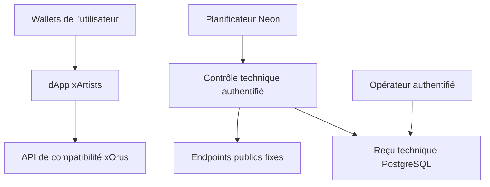

# xOrus — organisation commune et passerelle de plateformes

Ce service rattache les ressources à une seule organisation **logique** `xartists`. Il ne fusionne pas les comptes fournisseurs, ne déplace pas les fonds et ne multiplie pas les quotas gratuits. Les identifiants des cinq organisations évoquées par le propriétaire ne sont pas encore tous identifiés.

La première tranche livrée est une API de compatibilité et un contrôle technique horaire. **Ce n'est pas un bot exécutant des trades ou des paris**, ni une connexion effective aux wallets. Les décisions restent `ABSTAIN`, avec zéro signal de marché indépendamment vérifié. Aucun modèle IA payant ou gratuit n'est configuré dans ce service.

## Composants et limites de confiance



| Composant | Livré | Limite |
| --- | --- | --- |
| Registre commun | `/v1/xorus/platforms`, une organisation logique | Aucun transfert de compte fournisseur |
| Routage wallet | EVM, Solana, Bitcoin, MultiversX selon plateforme | Compatibilité déclarative ; aucun wallet lié |
| Contrôles réseau | Bitcoin, Solana, Polymarket, Kraken | Disponibilité technique ; aucune observation de prix |
| Planificateur | Trigger Neon `xorus-hub-hourly`, `17 * * * *` UTC | L'existence du fichier ne prouve pas le trigger actif |
| Stockage | Une ligne `xorus_platform_hub_state`, lease partagée entre isolates | Cible sandbox nominative exclusivement |
| Lectures opérateur | Bearer serveur distinct, jamais livré au navigateur | Ne remplace pas une session utilisateur ou une preuve wallet |
| Exécution / IA | Non implémentées | Refus HTTP 503 ; aucun flag ne les active |

Les réponses externes sont des données non fiables : URLs fixes, redirections refusées, timeout 5 secondes, réponses limitées à 8 KiB. Aucun contenu externe n'est interprété comme une instruction. Les échecs ne sont jamais remplacés par une fixture ou un ancien prix.

## Plateformes et wallets

| Cible | Nature | État de cette tranche |
| --- | --- | --- |
| Bitcoin | Réseau ; BTC est un actif, pas une plateforme d'exchange | Hauteur de chaîne utilisée uniquement pour valider la réponse technique |
| Solana | Réseau ; SOL et tokens SPL | RPC public, contrôle de slot uniquement ; pas un RPC de trading garanti |
| Polymarket | Marché prédictif | Heure serveur publique uniquement ; la France figure dans les pays bloqués |
| Kraken | Exchange centralisé | Heure serveur uniquement ; son compte/API ne se remplace pas par un wallet BTC |
| Jupiter | Agrégateur DEX Solana | Adaptateur de trading non configuré |
| MultiversX | Réseau de la dApp existante | Connecteur existant à prouver dans l'app ; pas de nouvelle signature ici |
| MetaWin | Jeux / casino | Manuel ; API publique d'automatisation officielle non vérifiée |

La FAQ MetaWin liste Ethereum, Arbitrum, Base, Polygon, Optimism, Blast et Solana. Une devise acceptée en dépôt ne démontre pas une connexion Web3 native sur le réseau correspondant. L'éligibilité doit être vérifiée pour l'utilisateur, le compte et le jeu. Le serveur, les wallets et l'hébergement ne servent pas à contourner une restriction géographique.

Les signatures restent dans les wallets utilisateur. Les seeds, clés privées, clés API d'exchange, signatures et même adresses publiques ne font pas partie du schéma de cette première API. `POST /v1/xorus/wallet-route` accepte **uniquement** :

```json
{"platform":"jupiter","network":"solana"}
```

Le résultat précise `connected=false`, `ownership_verified=false`, `executable=false`. Il ne crée pas de transaction, d'approbation, d'ordre ou de transfert.

## Cible et déploiement

- Organisation Neon observée : `org-crimson-thunder-31766993`, offre Free.
- Projet **unique** : `orange-dust-23862418`, `xartists-access-sandbox`, région `aws-eu-central-1`.
- Branche : `br-steep-sun-bab7l93p`, base `xartists_access` ; rôle injecté par Neon.
- Fonction nouvelle : `xorushub`, Node.js 24. Aucune fonction existante remplacée.
- Aucun changement DNS, MX, hot wallet, compte Stripe ou variable du backend existant.

1. `npm ci --ignore-scripts --no-audit --no-fund` dans ce dossier, puis `npm test`.
2. Relire la cible et appliquer **uniquement** `schema.sql` à la base sandbox identifiée. C'est une nouvelle table, pas une migration des comptes existants.
3. Versionner les sources puis produire le ZIP avec `python3 scripts/ops/package-xorus-hub.py` depuis la racine. Le ZIP contient les dépendances et les seuls modules runtime.
4. Déployer `xorushub` via le connecteur Neon avec `XARTISTS_SOURCE_SHA` égal au commit source poussé, `XORUS_HUB_TARGET_CONFIRMED=orange-dust-23862418` et un nouveau `XORUS_HUB_OPERATOR_TOKEN` aléatoire serveur. Ne jamais exposer ce token ou les variables injectées dans les réponses, logs ou artefacts.
5. Vérifier HTTPS : `/health` et `/v1/xorus/platforms` ; absence d'auth → 401 sur `/snapshot` et `/probe` ; tentative de pari/ordre → 503. Un faux header de trigger envoyé par le client doit être supprimé par Neon et produire 401.
6. Créer une seule fois le trigger nommé ci-dessus, vers `/v1/xorus/cron`. En cas de 404 fournisseur, conserver la fonction et déclarer le planificateur indisponible. Réutiliser un trigger déjà créé.
7. Contrôler un reçu réellement persisté et l'état du trigger avant d'annoncer une surveillance active. Le déploiement isolé n'est pas une mise en production de `access-api` ni du trading.

## Frais, erreurs et suite d'implémentation

Au 21 novembre 2026, Neon Free annonce 1 million d'invocations, 10 heures de capacité active et 400 heures en attente par mois, avec des limites **au niveau du compte et du projet**. À raison d'un cycle par heure : 720–744 cycles et au plus 2 976 appels techniques sortants par mois, hors tests manuels. Les quotas PostgreSQL, de transfert et les autres fonctions du compte sont partagés. Aucune offre payante n'est activée par ce code. Ce n'est ni du HFT ni une disponibilité garantie. Les frais des réseaux, des plateformes et d'une éventuelle inférence IA ne sont pas inclus.

| Échec | Comportement |
| --- | --- |
| Cible/base non configurée, SQL indisponible, lease perdue | 503, aucune exécution |
| Appel opérateur non authentifié | 401 avant tout accès DB ou fournisseur |
| Livraison trigger absente, incohérente, étrangère ou périmée | 400/401 avant tout travail |
| Deux cycles simultanés / cycle récent | Admission SQL atomique ; doublon ignoré |
| Timeout, réponse incorrecte, HTTP 429 | Source indisponible ; aucun retry en boucle |
| Reçu de plus de 90 minutes ou daté du futur | 503, `stale=true` |
| Demande de trading, pari ou signature | 503, `execution_not_implemented` |

Ordre pour les prochaines tranches : preuve de possession de chaque wallet dans la dApp ; éligibilité et contrat API de chaque plateforme ; données de marché avec droits vérifiés ; stratégie et simulation avec frais/slippage ; budgets et limites de perte ; revue d'un adaptateur de signature séparé. Une instruction globale « toutes plateformes » ne fournit pas ces paramètres.

Sources fournisseurs relues le 21 novembre 2026 : [Neon plans](https://neon.com/docs/introduction/plans), [triggers](https://neon.com/docs/compute/functions/triggers/overview), [Solana RPC](https://solana.com/docs/references/clusters), [Polymarket restrictions](https://help.polymarket.com/en/articles/13364163-geographic-restrictions), [MetaWin FAQ](https://metawin.com/faq/), [Kraken server time](https://docs.kraken.com/api/docs/rest-api/get-server-time/).
