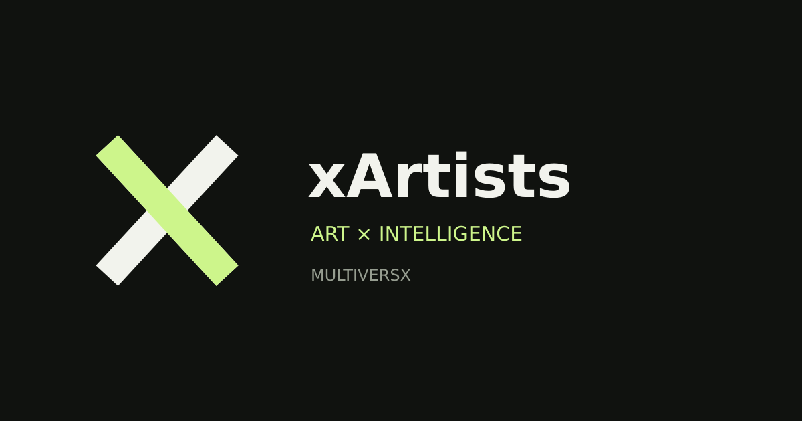

# xArtists — L'art rencontre une autre dimension

**xArtists** réunit des artistes, des œuvres numériques et physiques, un musée immersif, un Studio créatif et des outils d'intelligence artificielle sur MultiversX. **La visite est libre, sans wallet.**

[**Explorer la dApp**](https://xartists.art/) · [**Visiter le musée**](https://xartists.art/museum/) · [**Marketplace**](https://xartists.art/marketplace/) · [**Enchères**](https://xartists.art/auction/)

[**Vendre un NFT**](https://xartists.art/marketplace/#xa-market-sell) · [**Créer le NFT de ma sculpture**](https://xartists.art/studio/?mode=sculpture) · [**Lab 3D**](https://xartists.art/lab/?view=3d) · [**Plugins xArtists**](presentation/plugins-xartists.md) · [**Utiliser Drive/IPFS**](presentation/creer-vendre-nft-ipfs-drive.md)

Les **291 PNG** de la galerie Drive xArtists et les **4 MP4** du dossier vidéo historique sont des **fichiers privés inventoriés**, non des NFT mintés ; aucune propriété, licence ni publication IPFS n'est présumée. Le backend média nécessite le contrôle effectif de PostgreSQL (migrations 004 et 005), Pinata et de la signature wallet avant activation.

## Découvrir l'écosystème

| Expérience | Accès public | Ce qui reste fermé |
| --- | --- | --- |
| Musée | Visiter et découvrir les œuvres | L'exposition n'atteste pas la possession d'un NFT |
| Marketplace | Explorer le marché et préparer la vente d'un NFT détenu | Le premier nouveau listing signé et confirmé en escrow reste à prouver ; achat et bid ont des gates séparés |
| Enchères | Voir la salle et les exemples d'œuvres | Enchères et adjudications réelles |
| Studio | Photo/MP4/GLB local, préparation d'IPFS et mint par signature | L'upload réel dépend du backend ; premier mint de sculpture non attesté |
| xOrus | Voir des données publiées, agents et simulations | Trading autonome : mode paper/shadow |

[**Ouvrir xOrus**](https://xartists.art/intelligence/lia) · [**État des fonctionnalités**](presentation/etat-du-produit.md) · [**Guide mobile**](presentation/demarrer-sur-mobile.md)

## Les offres : ne pas confondre les produits

Les packs Genesis **Pulse (110 €), Yield (75 €), Sentinel (50 €)** sont présentés comme des produits à achat unique avec droits numériques associés. Les montants indiqués sont des **prix de catalogue**, pas des paiements activés ni des NFT déjà livrés.

**Whop / TCA Membership** correspond à des abonnements de services séparés, sans NFT Genesis inclus. Aucun de ces produits ne garantit un rendement financier.

[**Packs IA et Whop**](security/guide-public-packs-whop.md) · [**Offres xArtists**](https://xartists.art/offres/)

## Transparence et lancement

**11 novembre 2026 : code xOrus, Lab GLB et listing vendeur déployés au commit [969b3a96…](https://github.com/Neltud/xArtists/actions/runs/43093538589).** Un premier listing et le mint de sculpture signés restent à valider. Navigation Marketplace/Enchères et interface xOrus améliorées dans le dépôt GitHub. Une fusion de PR n'est pas en soi la preuve du déploiement sur tous les appareils.

Paiement, enchères réelles, mint automatique, bridge et trading nécessitent une vérification de bout en bout et des autorisations distinctes. Les données paper/shadow ne sont pas des gains réels.

Le présent GitBook est un guide visiteurs. Les runbooks, prompts d'agents et audits historiques sont retirés de la navigation publique ; certains fichiers techniques demeurent visibles dans le [dépôt GitHub](https://github.com/Neltud/xArtists), qui ne doit pas être confondu avec une documentation privée.

[**La Maison xArtists**](presentation/) · [**Confiance et transparence**](presentation/confiance-et-transparence.md) · [**English overview**](presentation/english-overview.md)
