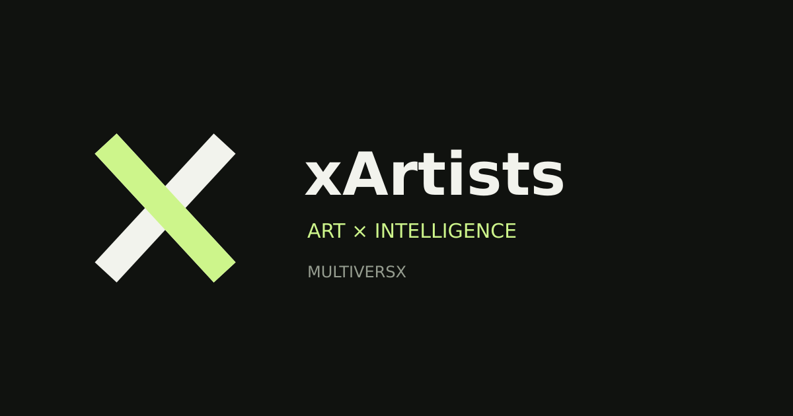

# La Maison xArtists — Art × Intelligence

**L'œuvre d'abord. La technologie au service de sa découverte.** xArtists relie création, provenance, espaces immersifs et outils intelligents dans une expérience accessible sans portefeuille.

[**Explorer xArtists**](https://neltud.github.io/xArtists/) · [**Manifeste**](maison-manifeste.md)

## Cinq portes d'entrée

| Espace | Utilité publique |
| --- | --- |
| **Musée** | Explorer les œuvres et l'univers artistique |
| **Marketplace** | Découvrir art numérique, œuvres physiques et packs, sans achat non attesté |
| **Enchères** | Consulter des aperçus de lots, sans possibilité actuelle d'enchère réelle |
| **Studio** | Prévisualiser images et vidéos ; publication IPFS et mint indépendants |
| **LIA Control Room** | Lire les données sourcées, les simulations et les agents Pulse, Yield, Sentinel |

[**Marketplace**](https://neltud.github.io/xArtists/marketplace/) · [**Enchères**](https://neltud.github.io/xArtists/auction/) · [**Control Room**](https://neltud.github.io/xArtists/intelligence/lia)

## À qui s'adresse xArtists ?

**Artistes :** présenter une démarche et explorer les futurs parcours phygitaux.  
**Collectionneurs :** comprendre les œuvres, leurs provenances et la distinction entre NFT et propriété physique.  
**Visiteurs :** découvrir sans connexion obligatoire.  
**Partenaires :** étudier les possibilités et le statut actuel du projet.

[**Artistes et créateurs**](artistes-et-createurs.md) · [**Collectionneurs**](collectionneurs-et-visiteurs.md) · [**Partenariats**](contribuer-et-partenariats.md)

## LIA et produits IA

Le trading LIA public est désactivé : son mode reste **paper/shadow**. Les données publiées peuvent être différées, et les performances simulées ne sont pas des gains réalisés.

Les packs Genesis sont des produits à **achat unique**. Les abonnements Whop/TCA relèvent d'une offre distincte. L'accès à une présentation n'implique pas une disponibilité immédiate du paiement ou de la livraison NFT.

[**LIA et agents IA**](lia-et-agents-ia.md) · [**Guide des packs**](../security/guide-public-packs-whop.md)

## Où en est le projet ?

**3 novembre 2026 :** découverte publique ouverte ; améliorations de navigation mobile et de lecture LIA fusionnées dans le code. Paiement PayBox public, mint mainnet automatique, enchères réelles, bridge et trading autonome toujours **fermés**.

[**État des fonctionnalités**](etat-du-produit.md) · [**Confiance**](confiance-et-transparence.md) · [**Démarrer sur mobile**](demarrer-sur-mobile.md)
