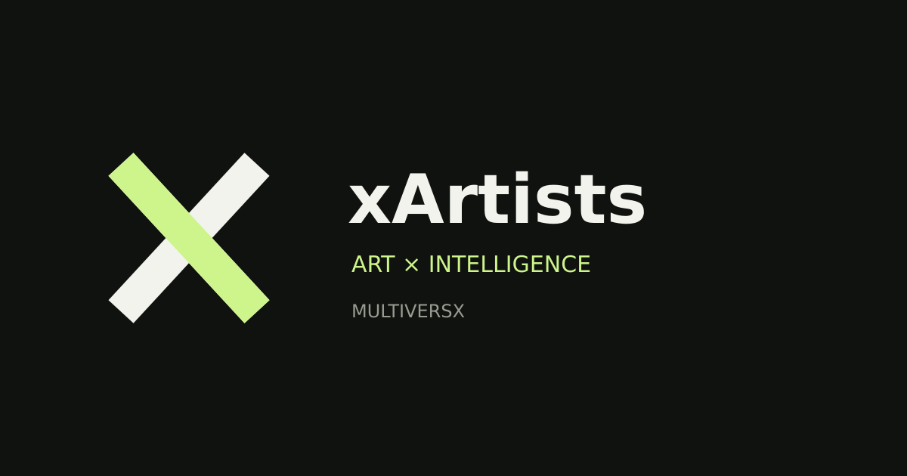

# xArtists — Projet et dapp

**L’art rencontre une autre dimension.**

xArtists réunit la découverte artistique, les outils de création et l’intelligence artificielle dans un écosystème sur **MultiversX**. Sa dapp permet d’explorer un musée, de découvrir des œuvres et des collections, de préparer un parcours de création et de consulter des outils d’intelligence.

La découverte publique commence sans portefeuille. Chacun peut choisir son chemin : visiter, créer, collectionner, apprendre ou comprendre le fonctionnement de LIA.

### Un projet à la croisée de l’art et du numérique

Une œuvre a un contexte, une histoire et des droits associés. xArtists cherche à relier ces éléments à une expérience accessible : une présentation visuelle, des informations de collection et, lorsque disponibles, des références vérifiables sur la blockchain.

Le projet porte aussi une ambition de transmission et de mise en relation des lieux artistiques. Les parcours culturels, TCA Academy et les liens entre œuvres physiques et représentations numériques participent à cette vision.

### Choisir son parcours

<table data-view="cards"><thead><tr><th></th><th></th><th data-hidden data-card-target data-type="content-ref"></th></tr></thead><tbody><tr><td><strong>Comprendre le projet</strong></td><td>La mission, les principes et l’ambition culturelle de xArtists.</td><td><a href="vision-et-mission.md">vision-et-mission.md</a></td></tr><tr><td><strong>Découvrir la dapp</strong></td><td>Les cinq espaces et un premier parcours de visite.</td><td><a href="decouvrir-la-dapp.md">decouvrir-la-dapp.md</a></td></tr><tr><td><strong>Artistes et créateurs</strong></td><td>Le Studio, les collections et les liens avec les œuvres physiques.</td><td><a href="artistes-et-createurs.md">artistes-et-createurs.md</a></td></tr><tr><td><strong>Collectionneurs et visiteurs</strong></td><td>Les œuvres, leurs références et les étapes d’une acquisition disponible.</td><td><a href="collectionneurs-et-visiteurs.md">collectionneurs-et-visiteurs.md</a></td></tr><tr><td><strong>LIA et agents IA</strong></td><td>Le mode paper et les profils Pulse, Yield et Sentinel.</td><td><a href="lia-et-agents-ia.md">lia-et-agents-ia.md</a></td></tr><tr><td><strong>Web, mobile et xPortal</strong></td><td>Ouvrir la dapp, l’ajouter à son écran d’accueil et comprendre la connexion.</td><td><a href="demarrer-sur-mobile.md">demarrer-sur-mobile.md</a></td></tr></tbody></table>

### L’état de la version publique

**Au 25 octobre 2026**, une version de découverte présente l’interface et les parcours mobiles. **LIA reste en simulation et le trading live est désactivé.** La sortie GitHub consolidée et le référencement officiel dans les catalogues restent soumis à leurs validations propres.

La page [Accès et disponibilité](etat-du-produit.md) rassemble les liens et le périmètre des services. Elle permet de distinguer une interface accessible, une simulation et une opération effectivement activée.

<a href="https://neltud.github.io/xArtists/" class="button primary">Ouvrir la dapp sur GitHub</a>

### Approfondir

| Sujet                           | Lecture                                                     |
| ------------------------------- | ----------------------------------------------------------- |
| $TRO et modèle du projet        | [$TRO et économie](tro-et-economie.md)                      |
| Données, portefeuille et droits | [Confiance et transparence](confiance-et-transparence.md)   |
| Prochaines étapes               | [Feuille de route](feuille-de-route.md)                     |
| Réponses pratiques              | [Questions fréquentes](questions-frequentes.md)             |
| Contributions et collaborations | [Contribuer et partenariats](contribuer-et-partenariats.md) |
| Présenter le projet en anglais  | [English overview](english-overview.md)                     |

Projet porté par **Nelson Tuduri / Neltud**. Le [dépôt public](https://github.com/Neltud/xArtists) permet de suivre son développement.
