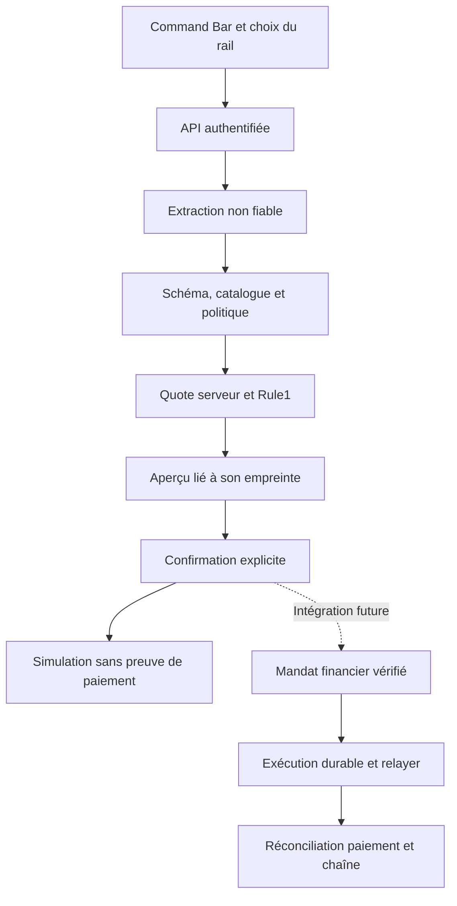
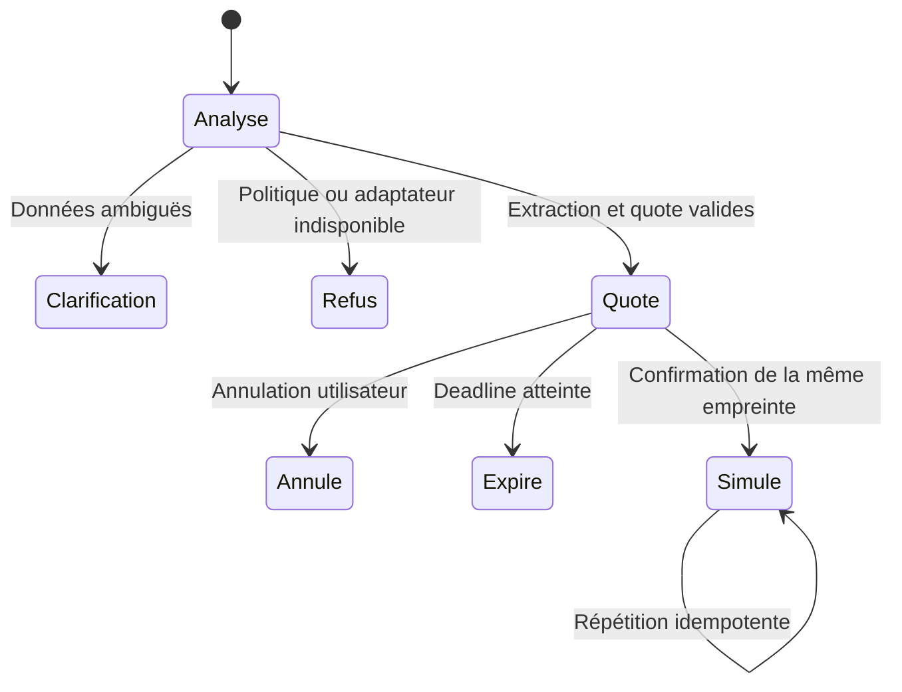

# LIA Intent — architecture et passage en production

Date : 4 novembre 2026. Périmètre livré : noyau TypeScript isolé, contrats Zod, QuoteGate Rule1 et parcours BUY_PACK simulé. L'intégration UI/API, les signatures, le relayer et les protocoles externes restent à réaliser et à vérifier.

## Choix d'architecture

Un workflow dirigé suffit : une extraction optionnelle par modèle, puis des validations et transitions déterministes. Un agent autonome avec outils d'écriture ou une équipe d'agents ajouterait ici des chemins d'exécution sans résoudre les prérequis de paiement et de livraison. L'extracteur ne reçoit ni clé, ni session d'authentification, ni outil financier. Sa confiance ne constitue pas une autorisation.

| Composant | Implémentation actuelle | Contrat à fournir par l'hôte |
|---|---|---|
| Extraction | Grammaire FR/EN bornée ; port modèle optionnel, validé, avec timeout et annulation | Un modèle à sortie structurée ; évaluation sur commandes françaises/anglaises ambiguës et hostiles |
| Catalogue | Prix en centimes injectés depuis le serveur ; empreinte du catalogue | Autorité `PACK_FIAT_CENTS`, version, disponibilité et droits réels de chaque pack |
| QuoteGate | Adaptateur du vrai `buildPackQuote`, ceil4 vérifié en entiers, marge interne de 4 %, TTL LIA ≤ 30 s | Lecture FX fiable, authenticité et persistance des quotes ; contrôle de solde avant tout débit futur |
| Mandat | `xartists.lia.paper_mandate.v1`, lié à l'utilisateur, au pack, au rail, au destinataire et à l'expiration | Consentement financier signé et vérifié, domaine, nonce, version du plan, bénéficiaire et plafonds |
| Planner | CREATE_ORDER → VERIFY_PAYMENT → REQUEST_DELIVERY → VERIFY_DELIVERY en paper | Adaptateurs réels distincts pour fiat et EGLD, sans mint déclenché par une réponse navigateur |
| Guardian | Snapshot serveur obligatoire ; erreur ou pause bloque ; limites quotidiennes et capacité bornées | Limites partagées entre instances, alertes et circuit breaker persistant |
| Registre | Un seul parcours autorisé, BUY_PACK ; huit autres actions reconnues mais refusées, UNKNOWN clarifie | Manifeste versionné, permissions et validation des adaptateurs avant extension |
| Journal | Mémoire bornée ; empreintes du texte et du mandat ; aucun texte brut dans le mandat | Stockage durable des transitions et preuves ; rétention, contrôle d'accès et métriques sans PII |

Les schémas reconnaissent `ESCROW_RELEASE` et les autres types annoncés. Reconnaissance syntaxique et permission d'exécution sont deux contrôles distincts. Les paramètres d'un autre type sont refusés, même si leur contenu semble plausible.

## Argent, quote et rails

Les prix actuels viennent du catalogue existant : Pulse 11 000 centimes, Yield 7 500, Sentinel 5 000. Le client ne peut ni fixer le catalogue ni fournir sa quote. Un prix explicitement extrait doit correspondre exactement au catalogue ; un pack sans prix affiche le prix serveur avant confirmation.

Le moteur historique expose encore des nombres JavaScript. L'adaptateur les convertit en décimaux canoniques puis vérifie en BigInt que la jambe EGLD correspond exactement à `ceil4(prixEUR / tauxEURparEGLD)`. Il refuse les exposants, la précision excessive, une remise/surcharge sur cette jambe et un écart d'arrondi supérieur à deux centimes. Aucune marge de 4 % n'est appliquée au montant payé. Une future migration du moteur à des décimaux natifs doit conserver les vecteurs de parité.

`eur_paybox` signifie paiement en centimes EUR. `egld_multiversx` signifie paiement en unités atomiques EGLD à 18 décimales. Un prix affiché en EUR ne sélectionne pas PayBox. Le taux EGLD du parcours fiat est une référence de quote, pas la preuve d'un paiement ou de la conversion du règlement vendeur.

L'expiration est le minimum de celle du moteur et de `issuedAt + 30 s`. Une re-quote produit un nouveau mandat et exige une nouvelle confirmation. Le solde est `not_checked`, le gas `not_quoted` et son estimation `null` dans ce premier lot ; ces inconnues bloquent une activation financière future.

## Confirmation et état

L'API de confirmation accepte seulement `{mandateId, digest}`. Elle relit le mandat stocké pour l'utilisateur authentifié. Elle n'accepte ni copie de plan, ni montant de remplacement, ni destinataire, ni signature fictive. La copie rendue à l'UI ne peut modifier l'état stocké. L'empreinte SHA-256 est une liaison d'intégrité du preview, **pas une signature ni une preuve d'autorisation financière**.

Le reçu paper conserve `paymentVerified: false`, `deliveryVerified: false`, `chainStatus: not_submitted`. Les steps sont `simulated`. Il ne contient ni hash chaîne, ni identifiant NFT, ni preuve de propriété ou de droit physique. Les préfixes XAIPLS/XAIYLD/XAISNT restent des familles commerciales ; un adaptateur live devra utiliser les identifiants complets et vérifiés des collections.

Pour le live futur, prévoir des états durables séparés : quoted, authorized, order_created, payment_pending, payment_verified, delivery_pending, delivery_verified, refund_pending, refunded, failed, cancelled, expired. Une signature ou un retour PSP HTTP 200 ne signifie pas paiement vérifié. Un dispatch de workflow ne signifie pas livraison. Un hash au bon format ne signifie pas finalité. Le commit de livraison doit corréler la commande, le paiement vérifié, le job, la collection, le NFT et son destinataire.

Un paiement finalisé et un transfert blockchain finalisé ne s'annulent pas par rollback logiciel. Un remboursement ou une compensation suit un parcours explicitement autorisé, idempotent et rapproché ; aucune répétition automatique d'écriture ambiguë.

## Interface prévue

| État | Contenu visible | Action |
|---|---|---|
| Saisie | Commande et badge Simulation | Analyser |
| Clarification | Pack/prix manquant ou choix EUR/EGLD ; aucun rail présélectionné | Préciser |
| Quote prête | Produit, quantité 1, prix, montant du rail choisi, wallet destinataire, réseau, expiration et frais inconnus | Simuler / Annuler |
| Expiré ou modifié | Quote expirée ou paramètres différents | Recalculer puis reconfirmer |
| Simulé | Parcours prévisualisé, aucun paiement ni NFT livré | Fermer ou préparer une autre commande |
| Refus | Motif public stable, reprise possible si Guardian/adapter rétabli | Réessayer uniquement la lecture |

Le bouton de la Command Bar existante sert aujourd'hui principalement à naviguer. Le futur hook `useLiaIntent()` devra distinguer navigation, préparation et simulation. Cmd/Ctrl+K, focus initial, Escape, restitution du focus, lecture du montant et annonce d'expiration doivent être vérifiés au clavier et sur mobile. Aucun bouton « Payer » ou « Mint confirmé » ne découle d'un résultat paper.

Une session SIWX prouve une connexion selon ses propres règles. Détenir un Genesis NFT peut donner accès à un tarif ou une fonctionnalité ; cela ne signe jamais un ordre de dépense. L'autorisation déléguée future exige un mandat utilisateur explicite avec portée, plafonds, expiration, révocation et protection anti-rejeu.

## API et permissions prévues

Ces routes sont un design ; elles ne sont pas exposées par cette PR.

| Route | Entrée client | Contrôles serveur | Effet |
|---|---|---|---|
| POST `/v1/lia/intents/prepare` | raw, paymentRail | Session, CSRF/origin selon transport, quota, schéma, catalogue, quote et Guardian | Crée un preview paper |
| POST `/v1/lia/intents/confirm-paper` | mandateId, digest | Même utilisateur, même empreinte, état, expiry, Guardian et quota | Reçu simulé |
| POST `/v1/lia/intents/cancel` | mandateId, digest | Même utilisateur et état annulable | Annulation locale durable à terme |
| GET `/v1/lia/intents/:id` | id | Propriété et filtrage du contenu | Statut sans donnée d'un autre utilisateur |

Le contrat d'une route d'autorisation financière reste distinct. Le déploiement du package ou une variable `VITE_*` ne doit pas l'activer. L'accès réseau des futurs adaptateurs sera limité à des hôtes configurés côté serveur, avec budgets, deadlines et réponses structurées. Les noms de tools et URLs provenant du modèle, d'un MCP tiers ou de métadonnées NFT ne sont jamais exécutés librement.

## Compatibilité des protocoles : preuves attendues

Vérification des documentations officielles le 4 novembre 2026 :

| Protocole | Contrat vérifié dans la documentation | Décision pour xArtists |
|---|---|---|
| AP2 | La spécification courante v0.2 distingue Checkout Mandate et Payment Mandate, vérification déterministe et liaison cryptographique au checkout signé | Épingler une révision et écrire des vecteurs de conformité. Le mandat interne paper n'annonce aucune conformité AP2 |
| ACP | MultiversX publie un adaptateur du protocole de commerce OpenAI/Stripe | Choisir l'implémentation/révision et tester les contrats checkout/complete/cancel ; ACP ne remplace pas le consentement wallet |
| Relayed v3 | Transaction avec `relayer` et `relayerSignature`, signatures utilisateur et relayer, contrainte de shard et coûts de gas | Vérifier le support dans le SDK réellement installé (13.17.2), simuler sur devnet puis prouver gas, nonce, guardian et erreurs avant adaptation mainnet |
| MX-8004 | Spécifications d'identité et de confiance des agents publiées par MultiversX | Vérifier identité/configuration/registre déployés ; l'identité de l'agent ne lui accorde aucun budget utilisateur |
| MCP | Surface de contexte et tools à schémas | Exposer d'abord preview/status via une façade authentifiée ; les descriptions de tools ne sont pas une autorisation d'écriture |

Les pages de présentation MultiversX et la spécification AP2 courante n'emploient pas toutes la même taxonomie des mandats. Cette divergence impose un choix de version explicite plutôt qu'une compatibilité supposée.

Sources primaires : [AP2 v0.2](https://ap2-protocol.org/ap2/specification/), [mandat de paiement AP2](https://ap2-protocol.org/ap2/payment_mandate/), [Relayed Transactions](https://docs.multiversx.com/developers/relayed-transactions/), [adaptateur ACP MultiversX](https://github.com/multiversx/mx-acp-adapter), [MX-8004](https://github.com/multiversx/mx-agent-standard), [standards MultiversX](https://agents.multiversx.com/standards).

## Genesis Art Engine comme premier adaptateur créatif

Le parcours créatif sera `brief → génération → édition → validation média/droits → pin metadata → preview mint → autorisation → mint vérifié`. La génération et le pinning ne doivent pas appeler mint. Réutiliser les contrôles existants de `creatorMedia.mjs` : identité artiste, limites, détection média, propriété et pinning serveur. Le prestataire de génération, ses coûts, sa disponibilité et les droits restent à sélectionner et mesurer.

Les collections de packs Genesis ne sont pas automatiquement les collections d'œuvres des créateurs. Définir le produit, les droits, la collection et les règles de royalties de chaque mint avant un adaptateur. Aucune promesse de revente, de rendement ou d'exécution universelle des royalties.

La première monétisation à implémenter est un compteur paper d'usage et de coûts : prix affiché avant génération, réservation de crédits, capture seulement après résultat accepté selon une politique explicite, clé d'idempotence et remboursement de réservation en cas d'échec. Les frais, remises Genesis et ventilation treasury/créateur doivent être versionnés et liés au consentement. Les pourcentages de revenus proposés restent des hypothèses commerciales, pas des résultats observés.

## Backlog et conditions de sortie

Le backlog associé à cette PR ordonne les travaux suivants : intégration API/UI paper, évaluation de l'extraction structurée, journal durable et autorisations signées, adaptateurs paiement/livraison, Relayed v3 et conformité des protocoles, puis Genesis Art Engine et comptage des crédits. Chaque ticket doit définir une preuve de refus et une preuve de parcours nominal.

Le package paper peut être revu sans activer le paiement. L'ouverture commerciale requiert en plus : publication correcte des routes et assets ([#362](https://github.com/Neltud/xArtists/issues/362)), chaîne paiement/IPN/livraison et journal de mint opérationnels avec remboursement testé ([#281](https://github.com/Neltud/xArtists/issues/281)), et revue humaine indépendante avant merge/déploiement. Les validations de routes dans une PR frontend distincte ne prouvent pas l'exécution des actions financières.

Le TRO Solana demeure une représentation 1:1 choisie précédemment. La preuve SPL locale à quantité zéro n'établit ni réserves, ni bridge, ni adresse de dépôt mainnet. Son ouverture exige ses propres preuves de custody, émission/rachat, autorités et audit ([#298](https://github.com/Neltud/xArtists/issues/298)). Aucun de ces points n'est activé par ce lot LIA.

Arrêt : désactiver l'intégration hôte ou mettre Guardian en pause. Retour arrière : retirer l'import/route du package ; cette PR n'effectue aucune migration de base ni écriture financière. Le retrait du code ne constitue jamais un rollback d'une transaction finalisée d'un futur adaptateur live.
